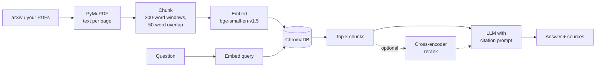

# Paper Q&A

Ask questions across a folder of research papers and get answers that cite the exact paper and page they came from.

Built as a small, readable retrieval-augmented generation (RAG) pipeline: PDF parsing, chunking, dense retrieval with optional cross-encoder reranking, grounded generation with citations, and a retrieval evaluation harness.

<!-- Add a screenshot or GIF of the app here:  -->

## Features

- **Fetch papers from arXiv** by topic with one command
- **Cited answers**: every claim points to a numbered source; arXiv sources link straight to the cited page
- **Grounded by design**: the model is told to answer only from retrieved passages and to say when the answer isn't there
- **Optional reranking** with a cross-encoder for better precision
- **Retrieval evaluation**: hit@k and MRR on your own question set, with side-by-side comparison of chunking and reranking settings
- **Runs fully locally** (sentence-transformers + ChromaDB + Ollama), or against any OpenAI-compatible API

## How it works



## Quickstart

```bash
git clone <your-repo-url> && cd paper-qa
python -m venv .venv && source .venv/bin/activate   # Windows: .venv\Scripts\activate
pip install -r requirements.txt
```

**Pick an LLM.** Local: install [Ollama](https://ollama.com) and run `ollama pull llama3.2`. Hosted: `cp .env.example .env` and fill in the `LLM_*` values for any OpenAI-compatible provider.

**Get papers and index them:**

```bash
python fetch_papers.py "dataset poisoning detection" -n 30   # or drop your own PDFs into papers/
python ingest.py
```

**Ask questions:**

```bash
streamlit run app.py
# or from the terminal:
python rag.py "Which methods detect poisoned samples using frozen feature extractors?"
```

## Evaluation

Retrieval is the part of RAG that most often fails silently, so this project measures it.

1. The repo ships a 30-question eval set on poisoning and backdoor detection (`data/eval_questions.example.jsonl`), written against the 32 papers in `data/eval_papers.txt`. Questions paraphrase each method rather than naming it, and three have more than one correct paper. Download that exact paper set and activate the questions:
   ```bash
   python fetch_papers.py --ids-file data/eval_papers.txt
   cp data/eval_questions.example.jsonl data/eval_questions.jsonl
   ```
   For your own corpus, write questions in the same format: each line has a question and the arXiv ID (or any unique part of the filename) of the paper that answers it.
2. Build a few collections with different settings:
   ```bash
   python ingest.py --collection chunks_150 --chunk-size 150 --overlap 25
   python ingest.py --collection chunks_300 --chunk-size 300 --overlap 50
   python ingest.py --collection chunks_600 --chunk-size 600 --overlap 100
   ```
3. Compare them, with and without reranking:
   ```bash
   python eval.py --collections chunks_150 chunks_300 chunks_600 --with-rerank -v
   ```
4. Spot-check answer quality: `python eval.py --collections chunks_300 --answers` writes a review file in `results/` with a checklist per answer.

### Results

<!-- Paste the table from results/retrieval_*.md here and add 2-3 sentences on what you found. -->

| Collection | Rerank | Hit@5 | MRR |
|---|---|---|---|
| chunks_150 | no | – | – |
| chunks_300 | no | – | – |
| chunks_600 | no | – | – |

Something to look for: `bge-small` reads at most 512 tokens, so 600-word chunks (~800 tokens) get truncated when embedded. The end of each chunk is invisible to retrieval even though it is still sent to the LLM.

## Project structure

```
paper-qa/
├── app.py             # Streamlit chat UI
├── rag.py             # retrieval, reranking, prompt and generation
├── ingest.py          # PDF -> chunks -> embeddings -> ChromaDB
├── fetch_papers.py    # download papers from the arXiv API
├── eval.py            # hit@k / MRR evaluation + answer review file
├── config.py          # all settings, overridable via .env
├── data/              # evaluation questions
├── papers/            # PDFs + index.json (titles, URLs)
└── results/           # evaluation outputs
```

## Design decisions

- **Word-based chunking with page tracking.** No tokenizer dependency, and every chunk knows which pages it spans, so citations can name the page.
- **Normalized embeddings with Chroma's default L2 distance.** For unit vectors, squared L2 distance equals 2 − 2·cosine, so ranking is identical to cosine similarity and the score shown in the app is the cosine.
- **OpenAI-compatible client for the LLM.** One code path works with Ollama locally and with most hosted providers, configured only through `.env`.
- **Retrieve 20, rerank to k.** The bi-encoder is fast but approximate; the cross-encoder reads question and passage together and is more accurate, so it only re-orders a small candidate set.

## Limitations and next steps

- Scanned PDFs have no text layer and are skipped (no OCR).
- Tables, figures and equations come through as flattened text.
- Each question is answered independently; there is no chat memory.
- Ideas: hybrid search (BM25 + dense), section-aware chunking, metadata filters (year, author), automatic faithfulness scoring.

## What I learned

<!-- Your notes: what surprised you in the eval results, what broke, what you'd change. -->
